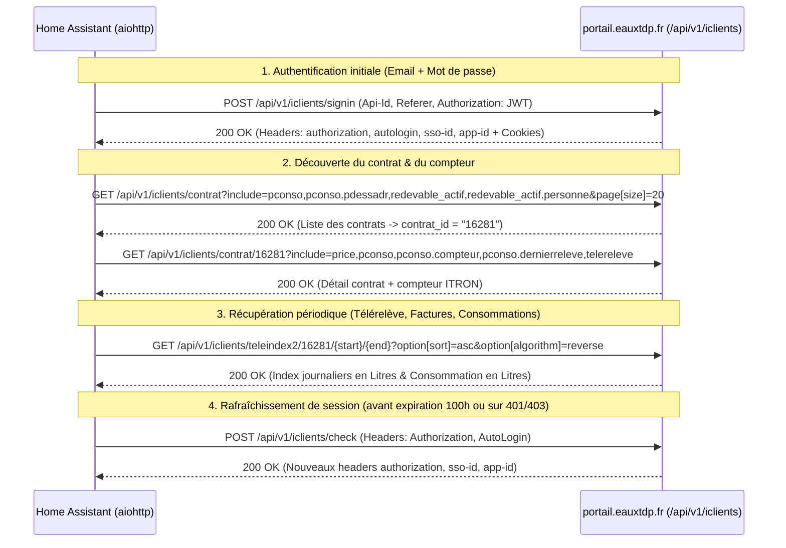

# Spécification Technique & Cartographie API — Portail Eaux Terre de Provence (`portail.eauxtdp.fr`) pour Home Assistant

Ce document constitue la spécification technique complète issue de la rétro-ingénierie du portail abonné **[https://portail.eauxtdp.fr](https://portail.eauxtdp.fr)** (Régie des Eaux de Terre de Provence). Il est destiné à un agent de développement chargé de coder une intégration personnalisée (`custom_component`) pour **Home Assistant**.

---

## 1. Vue d'Ensemble & Absence de Swagger / OpenAPI

### 1.1. Résultat de la recherche Swagger / OpenAPI
Aucune documentation publique Swagger ou OpenAPI n'est exposée sur le serveur :
- Les chemins `/api/swagger.json`, `/api/openapi.json`, `/api/doc`, `/api/docs`, `/api/v1/doc`, `/api/v1/swagger.json`, `/api/v1/iclients/doc`, `/api/v1/iclients/swagger.json`, `/api/api-docs` et `/openapi.json` renvoient tous **HTTP 404**.
- Le chemin `/swagger.json` renvoie le `index.html` de la SPA React (fallback du routeur frontend).

### 1.2. Stack Technique Identifiée
L'analyse des bundles JavaScript de production (`/assets/index-CWAkZDgv.js` et `/assets/app-shared-DbJvSCTq.js`) et des échanges réseau révèle l'architecture suivante :
- **Solution logicielle** : **JVS-Mairistem — Pôle OMEGA (`omega-portail` / `iClients` v3.34.13)**.
- **Standard d'échange** : **JSON:API v1.0** (`Content-Type: application/vnd.api+json`, `Accept: application/vnd.api+json`).
- **Base URL API** : `https://portail.eauxtdp.fr/api` (tous les appels métier sont sous `/api/v1/iclients/...`).
- **Identifiant statique du Tenant (`Api-Id`)** :
  ```text
  00ab80a941962fc608283fead90150ed@iclients-09064-terredeprovence
  ```
- **Partenaire Télérelève** : **Birdz** (compteur **ITRON** avec module radio **HOMG3**).
- **Sécurité / MFA / Captcha** : Dans la configuration compilée du portail (`be`), **MFA est désactivé** (`be.mfa = undefined`), **Captcha est désactivé** (`be.auth.captcha = false`), et **FranceConnect est désactivé** (`be.auth.franceconnect.active = false`). L'authentification se fait donc en **une seule requête POST directe**.

---

## 2. Prérequis Réseau & Règles WAF (Critique — Anti-401/403)

> [!CAUTION]
> **Blocage WAF Apache (HTTP 403 Forbidden)** : Le serveur frontal bloque toute requête API provenant d'un script Python/`aiohttp` ou Node.js si l'en-tête **`Referer`** (et un **`User-Agent`** standard) n'est pas présent. Sans `Referer: https://portail.eauxtdp.fr/`, l'API rejette systématiquement les appels avec un code `403 Forbidden` (et `Origin` seul ne suffit pas).

### En-têtes HTTP obligatoires sur TOUTES les requêtes

| En-tête HTTP | Valeur requise | Rôle |
| :--- | :--- | :--- |
| `Api-Id` | `00ab80a941962fc608283fead90150ed@iclients-09064-terredeprovence` | Identifie la collectivité (Régie des Eaux de Terre de Provence) auprès du broker JVS |
| `Referer` | `https://portail.eauxtdp.fr/` | **Obligatoire** (vérifié par le serveur/WAF ; renvoie `403` si omis) |
| `User-Agent` | `Mozilla/5.0 (X11; Linux x86_64) AppleWebKit/537.36 (KHTML, like Gecko) Chrome/130.0.0.0 Safari/537.36` | **Obligatoire** lors de l'initialisation à froid (renvoie `403` Apache si `User-Agent` non-navigateur) |
| `Accept` | `application/vnd.api+json` | Format de réponse JSON:API |
| `Content-Type` | `application/vnd.api+json` | Format de corps de requête JSON:API (sur `POST`/`PUT`) |
| `Authorization` | `JWT` (avant login) puis `Jwt id="<token_jwt>"` (après login) | Jeton d'authentification signé RS256 |
| `Sso-Id` | `<32_hex_chars>` (ex: `5e25a6a9fc9eff5f316dc610bf8ea0e5`) | Identifiant de session SSO (reçu dans le header `sso-id` ou cookie `Sso-Id`) |
| `App-Id` | `<32_hex_chars>` (ex: `e7ece8fc1829f668d66dc71057cfcd24`) | Identifiant d'instance d'application (reçu dans le header `app-id` ou cookie `App-Id`) |

> [!TIP]
> **Gestion des cookies vs headers** : Le backend accepte indifféremment `Sso-Id` et `App-Id` via les **cookies** (gérés automatiquement par `aiohttp.ClientSession`) **ou** via les **en-têtes HTTP** explicites `Sso-Id` et `App-Id`. Pour une fiabilité maximale dans Home Assistant, conservez le `CookieJar` de `aiohttp.ClientSession` **et** injectez explicitement les headers `Authorization`, `Sso-Id`, `App-Id` et `Api-Id`.

---

## 3. Flux d'Authentification & Gestion de Session



### 3.1. Connexion (`POST /api/v1/iclients/signin`)
- **URL** : `https://portail.eauxtdp.fr/api/v1/iclients/signin`
- **Méthode** : `POST`
- **En-têtes** :
  ```http
  Api-Id: 00ab80a941962fc608283fead90150ed@iclients-09064-terredeprovence
  Authorization: JWT
  Accept: application/vnd.api+json
  Content-Type: application/vnd.api+json
  Referer: https://portail.eauxtdp.fr/public/connexion
  User-Agent: Mozilla/5.0 (X11; Linux x86_64) AppleWebKit/537.36 (KHTML, like Gecko) Chrome/130.0.0.0 Safari/537.36
  ```
- **Corps de la requête (JSON:API généré par `js({type: "POICL_Signin", login, password, remember: true})`)** :
  ```json
  {
    "data": {
      "type": "POICL_Signin",
      "id": "",
      "attributes": {
        "login": "utilisateur@exemple.fr",
        "password": "VOTRE_MOT_DE_PASSE",
        "remember": true
      }
    }
  }
  ```
- **En-têtes de réponse (`200 OK`) à capturer impérativement** :
  - `authorization` : `Jwt id="eyJ0eXAiOiJKV1QiLCJhbGciOiJSUzI1NiJ9..."`
  - `autologin` : Jeton de reconnexion longue durée (valable 1 an si `remember: true`)
  - `sso-id` : ex. `5e25a6a9fc9eff5f316dc610bf8ea0e5`
  - `app-id` : ex. `e7ece8fc1829f668d66dc71057cfcd24`
  - `Set-Cookie` : `Sso-Id`, `App-Id`, `Api-Id`, `OGAWEB2227`
- **Corps de la réponse (`200 OK`)** : Entité `POICL_User` (identique à la réponse de `/check` ci-dessous).

### 3.2. Anatomie du JWT (`Authorization`)
Le header `Authorization` a un format spécifique : `Jwt id="<TOKEN>"` (attention à la casse `Jwt id="..."` avec guillemets).
Le décodage Base64 du payload JWT donne :
```json
{
  "iss": "portail.eauxtdp.fr",
  "sub": "api",
  "aud": {
    "id": 1306636,
    "login": "utilisateur@exemple.fr",
    "ip": "203.0.113.10",
    "ssoid": "5e25a6a9fc9eff5f316dc610bf8ea0e5"
  },
  "iat": 1792479324,
  "exp": 1792839324
}
```
> [!IMPORTANT]
> **Points d'attention sur le JWT** :
> 1. **Durée de validité** : `exp - iat = 360 000 secondes` (**100 heures**, soit ~4 jours et 4 heures).
> 2. **Liaison à `ssoid` et `ip`** : Le JWT contient le `ssoid` (qui doit correspondre au header/cookie `Sso-Id`) ainsi que l'adresse IP publique (`aud.ip`). Si l'IP WAN de la box internet change ou si la session SSO expire côté serveur, l'API renverra `401` ou `403`. L'intégration Home Assistant doit donc intercepter tout code `401`/`403`, tenter un `POST /api/v1/iclients/check` avec `AutoLogin`, et en cas d'échec, refaire automatiquement un `POST /api/v1/iclients/signin` avec les identifiants stockés dans `ConfigEntry`.

### 3.3. Vérification / Rafraîchissement de Session (`POST /api/v1/iclients/check`)
- **URL** : `https://portail.eauxtdp.fr/api/v1/iclients/check`
- **Méthode** : `POST`
- **En-têtes additionnels** : `Authorization: Jwt id="..."` et, si disponible, `AutoLogin: <autologin_token>`
- **Corps** : `{}`
- **Réponse (`200 OK`)** :
  ```json
  {
    "jsonapi": { "version": "1.0" },
    "data": {
      "type": "POICL_User",
      "id": "1306636",
      "attributes": {
        "user_login": "utilisateur@exemple.fr",
        "user_email": "utilisateur@exemple.fr",
        "user_title": "OTHER",
        "user_type": "USER",
        "user_banned": false,
        "user_phone_ts": "2025-10-14T21:04:02+02:00"
      }
    }
  }
  ```

---

## 4. Endpoints Métier Principaux (Consommation, Prix, Compteur, Factures)

### 4.1. Liste des Contrats (`GET /api/v1/iclients/contrat`)
Permet de découvrir automatiquement le(s) `contrat_id` rattachés au compte lors du `ConfigFlow` Home Assistant.
- **URL** :
  ```text
  GET /api/v1/iclients/contrat?include=pconso,pconso.pdessadr,redevable_actif,redevable_actif.personne&page[size]=20
  ```
- **Champs clés extraits de `data[]` (`type: "POICL_Contrat"`)** :
  - `id` : `"16281"` (**identifiant interne du contrat `contrat_id`**, utilisé dans toutes les autres URLs !)
  - `attributes.numcontrat` : `"042506100070"` (numéro de contrat affiché à l'usager)
  - `attributes.actif` : `true`
  - `attributes.datedeb` : `"2010-04-02T00:00:00+02:00"`
  - `attributes.assujetti_a` : `"EAU/ASST"`

---

### 4.2. Détail du Contrat, Compteur & Prix de l'Eau (`GET /api/v1/iclients/contrat/{contrat_id}`)

- **URL optimale à appeler** :
  ```text
  GET /api/v1/iclients/contrat/16281?include=price,pconso,pconso.pdessadr,pconso.compteur,pconso.dernierreleve,telereleve
  ```
- **Entités retournées dans `included[]`** :

#### A. Tarif de l'eau (`type: "POICL_Price"`) vs Tarif Réel Facturé (`facture_859880.pdf`)
```json
{
  "type": "POICL_Price",
  "id": "16281",
  "attributes": {
    "price": 8.24,
    "price_eht": 1.99,
    "price_ettc": 2.1,
    "price_aht": 5.58,
    "price_attc": 6.14,
    "__ts": 1792480587.196489
  }
}
```
| Attribut API (`POICL_Price`) | Valeur retournée | Signification dans l'API |
| :--- | :--- | :--- |
| `price` | `8.24` | Somme `price_ettc` (2,10 €) + `price_attc` (6,14 €) |
| `price_eht` / `price_ettc` | `1.99` / `2.10` | Estimation interne Eau potable HT / TTC (€/m³) |
| `price_aht` / `price_attc` | `5.58` / `6.14` | Estimation interne Assainissement HT / TTC (€/m³) |

> [!WARNING]
> **Écart critique entre `POICL_Price` (`8,24 €/m³`) et la facture réelle (`3,73 €/m³` hors abonnement)** :
> L'analyse de la facture réelle **`facture_859880.pdf`** (Facture n° `26801` du `22/09/2026`, ID API `859880`) démontre que la valeur `8.24 €/m³` renvoyée par `POICL_Price` (notamment `price_attc: 6.14`) **ne correspond pas au tarif réel facturé** par la Régie des Eaux de Terre de Provence.
> **Il ne faut donc PAS utiliser `POICL_Price.price` par défaut pour calculer le coût dans Home Assistant**, sous peine de plus que doubler le coût réel ! Voir la **Section 4.7** ci-dessous pour la grille tarifaire exacte extraite de la facture et les formules de calcul recommandées.

#### B. Compteur physique & Module Radio (`type: "POICL_Compteur"`)
```json
{
  "type": "POICL_Compteur",
  "id": "84447",
  "attributes": {
    "numserie": "I24BB043993",
    "enum_marq": "ITRON",
    "enum_diam": "20",
    "enum_calib": "20",
    "dateinst": "2025-10-14T00:00:00+02:00",
    "anneefab": 2024,
    "releve_radio": true,
    "rrmodereleve": "MRRAD",
    "rrtypemodule": "HOMG3",
    "rrnsmodule": "532263812349950C",
    "compteur_actif": true,
    "flag_alerte": false,
    "chaine_alerte": null
  }
}
```

#### C. Point de livraison Télérelève (`type: "PORLV_Pdl"`)
```json
{
  "type": "PORLV_Pdl",
  "id": "25346",
  "attributes": {
    "rlp_id_externe": "TR-3847",
    "rlp_numserie": "I24BB043993",
    "rlp_nummodule": "532263812349950C",
    "rlp_ts": "2026-05-07T14:27:55+02:00",
    "pconso_id": 3847
  }
}
```

#### D. Adresse de desserte (`type: "POICL_Pdessadr"`) & Point de consommation (`type: "POICL_Pconso"`)
- `POICL_Pdessadr` : `numvoirie: "10"`, `nomvoie: "RUE DE LA REPUBLIQUE"`, `cp: "13550"`, `ville: "NOVES"`.
- `POICL_Pconso` : `sigcoord: "43.877000|4.900000||"` (coordonnées GPS `lat|lon`), `cptferme: false`, `cptfuite: 0`.

---

### 4.3. Télérelève Journalière (`GET /api/v1/iclients/teleindex2/{contrat_id}/{start}/{end}`)
C'est l'endpoint central pour le suivi quotidien de la consommation d'eau.

- **URL** :
  ```text
  GET /api/v1/iclients/teleindex2/{contrat_id}/{start_YYYYMMDD}/{end_YYYYMMDD}?option[sort]=asc&option[algorithm]=reverse
  ```
- **Exemple réel** :
  ```text
  GET /api/v1/iclients/teleindex2/16281/20261012/20261019?option[sort]=asc&option[algorithm]=reverse
  ```
- **Paramètres** :
  - `{contrat_id}` : ID interne du contrat (ex. `16281`).
  - `{start_YYYYMMDD}` : Date de début au format `YYYYMMDD` sans tirets (ex. `20261012` pour une vue semaine, ou `20260912` pour une vue mois).
  - `{end_YYYYMMDD}` : Date de fin au format `YYYYMMDD` sans tirets (le portail utilise la veille `J-1` comme borne de fin par défaut).
  - `option[sort]` : `asc` (tri chronologique croissant).
  - `option[algorithm]` : `reverse` (valeur configurée dans `be.partners.jvs["remote-meter-readings"].algorithm`).
- **Réponse JSON:API (`data[]` d'objets `type: "PORLV_Teleconso2"`)** :
  ```json
  {
    "jsonapi": { "version": "1.0" },
    "meta": {
      "ts": 1792480293.906477,
      "count": 8
    },
    "data": [
      {
        "type": "PORLV_Teleconso2",
        "id": "9da5027b36b9eda562cc21221c98c77d",
        "attributes": {
          "partner": "birdz",
          "id_externe": "TR-3847",
          "numserie": "I24BB043993",
          "nummodule": "532263812349950C",
          "typerlv": "TÉLÉRELÈVE",
          "dateni": "2026-10-15 02:00:00",
          "ni": 108531,
          "nie": 108531,
          "previous_dateni": "2026-10-14 02:00:00",
          "previous_ni": 107941,
          "after_dateni": "2026-10-16 02:00:00",
          "after_ni": 108782,
          "l": 251,
          "m3": 0,
          "add": false,
          "estimated_consumption": false,
          "__ts": 1792480293.903267
        }
      },
      {
        "type": "PORLV_Teleconso2",
        "id": "6af03895232c59078c71681f546b7079",
        "attributes": {
          "partner": "birdz",
          "id_externe": "TR-3847",
          "numserie": "I24BB043993",
          "nummodule": "532263812349950C",
          "typerlv": "TÉLÉRELÈVE",
          "dateni": "2026-10-16 02:00:00",
          "ni": 108782,
          "nie": 108782,
          "previous_dateni": "2026-10-15 02:00:00",
          "previous_ni": 108531,
          "after_dateni": null,
          "after_ni": null,
          "l": null,
          "m3": null,
          "add": false,
          "estimated_consumption": null,
          "__ts": 1792480293.903364
        }
      },
      {
        "type": "PORLV_Teleconso2",
        "id": "completion_6",
        "attributes": {
          "partner": "birdz",
          "id_externe": "TR-3847",
          "numserie": "I24BB043993",
          "nummodule": "532263812349950C",
          "typerlv": "TÉLÉRELÈVE",
          "dateni": "2026-10-17",
          "ni": null,
          "nie": null,
          "previous_dateni": "2026-10-16 02:00:00",
          "previous_ni": 108782,
          "after_dateni": null,
          "after_ni": null,
          "l": null,
          "m3": null,
          "add": true,
          "estimated_consumption": null,
          "__ts": 1792480293.903364
        }
      }
    ]
  }
  ```

> [!WARNING]
> **Règles d'interprétation critiques de `PORLV_Teleconso2` (à implémenter absolument)** :
> 1. **Unité de `ni` (Nouvel Index)** : Dans `teleindex2`, `ni` est exprimé en **LITRES** (entier), soit **`108 782 L = 108,782 m³`** ! (Alors que dans les endpoints de facturation `/releve` et `/consomme`, `ni` est exprimé en **m³** entiers, ex. `96 m³`).
> 2. **Ne JAMAIS utiliser l'attribut `m3`** : L'attribut `m3` de `PORLV_Teleconso2` est une division entière (`int(l / 1000)`), il vaut donc `0` tant que la consommation journalière est inférieure à 1 000 L ! Pour obtenir des m³, calculez toujours **`ni / 1000.0`** (index cumulé en m³) ou **`l / 1000.0`** (consommation du jour en m³).
> 3. **Filtrage des entrées `add: true` (`id: "completion_*"`)** : Les jours récents dont la télérelève Birdz n'est pas encore remontée (délai radio habituel de 24h à 72h) sont complétés par le backend avec `add: true` et `ni: null`. Il faut **filtrer (`item.attributes.add === false && item.attributes.ni !== null`)** pour trouver le dernier index réel connu.
> 4. **Subtilité de `algorithm=reverse` vs `algorithm=chronological`** :
>    - Avec `algorithm=reverse` (utilisé par le portail), `l` sur la ligne du `2026-10-15` vaut `after_ni - ni` (`108782 - 108531 = 251 L`), soit la consommation entre le 15/10 à 02h00 et le 16/10 à 02h00. Par conséquent, sur le **dernier relevé reçu** (`2026-10-16 02:00:00`), `ni` est bien renseigné (`108782`), mais `after_ni` et `l` valent `null` en attendant le relevé du 17/10 !
>    - La consommation entre l'avant-dernier relevé et le dernier relevé (`2026-10-15 02:00` → `2026-10-16 02:00`) est déjà portée par `ni - previous_ni` (`108782 - 108531 = 251 L`).

---

### 4.4. Relevés Facturés (`GET /api/v1/iclients/releve/contrat/{contrat_id}`)
Retourne l'historique des relevés semestriels officiels (en m³).
- **URL** :
  ```text
  GET /api/v1/iclients/releve/contrat/16281?include=pconso,compteur&sort=-dateni,-dateai,-releve_id
  ```
- **Attributs de `POICL_Releve`** :
  - `dateai` : `"2026-03-09T00:00:00+01:00"` (date ancien index)
  - `ai` : `44` (ancien index en m³)
  - `dateni` : `"2026-09-07T00:00:00+02:00"` (date nouvel index)
  - `ni` : `96` (nouvel index en m³)
  - `consorlv` : `52` (consommation relevée sur la période en m³)
  - `enum_crlv` : `"R"` (`R` = Réel, `E` = Estimé)
  - `radiorlv` : `false` / `true`
  - `cptfuite` : `false` (indicateur de fuite lors de la relève)

---

### 4.5. Historique des Consommations Facturées (`GET /api/v1/iclients/consomme`)
- **URL** :
  ```text
  GET /api/v1/iclients/consomme?filter[and][contrat_id][eq]=16281&sort=-dateni&include=pconso,pconso.counter
  ```
- **Attributs de `POICL_Consomme`** :
  - `exercice` : `2026`
  - `dateai` / `dateni` : Période de consommation
  - `ai` / `ni` : Index début / fin (en m³)
  - `consorlv` : `107` (m³ relevés sur l'exercice)
  - `consofact` : `107` (m³ facturés)

---

### 4.6. Factures & Échéancier de Paiement
#### A. Liste des factures (`GET /api/v1/iclients/facture`)
- **URL** :
  ```text
  GET /api/v1/iclients/facture?sort=-datefact&filter[and][contfact.contrat_id][eq]=16281
  ```
- **Attributs de `POICL_Facture` (ex. dernière facture `id: "859880"`)** :
  - `nofacture` : `"26801"`
  - `datefact` : `"2026-09-22T00:00:00+02:00"`
  - `typefact` : `"Solde mensualisation"` ou `"Réelle"`
  - `consofac` : `"107"` (m³ facturés)
  - `ht` : `445.85` (€)
  - `tva` : `34.84` (€)
  - `ttc` : `480.69` (€)
  - `mensualites` : `388.17` (€ déjà prélevés en mensualités)
  - `nap` : `92.52` (€ Net À Payer)
  - `h_soldee` : `true` (facture soldée oui/non)
  - `h_restant` : `0` (€ restant à payer)
  - `datech` : `"2026-10-10T00:00:00+02:00"` (date d'échéance / prélèvement)
  - `pdf_filename` : `"F_859880.pdf"`

#### B. Échéancier / Prochains règlements (`GET /api/v1/iclients/contrat/reglements/{contrat_id}`)
- **URL** :
  ```text
  GET /api/v1/iclients/contrat/reglements/16281?include=hfact,moderegl
  ```
- **Attributs de `POICL_Hreglmnt`** :
  - `dateregl` : `"2026-11-10T00:00:00+01:00"` (date du prochain prélèvement mensuel)
  - `ttc` : `"48.07"` (montant en € de l'échéance — correspond exactement à l'échéancier de 9 mensualités de `48,07 €` du `10/11/2026` au `10/07/2027` imprimé au bas de la facture !)
  - `enum_stregl` : `"NEXP"` (Non exporté / À venir) ou `"OK"` (Payé)
  - `avance` : `true` (mensualité d'avance)

---

### 4.7. Analyse de la Facture Réelle (`facture_859880.pdf`) & Grille Tarifaire 2026

L'analyse de la facture **`facture_859880.pdf`** (*Solde mensualisation n°2026-EA-00-26801 du 22/09/2026*, correspondant à l'objet `POICL_Facture` `id: "859880"`) permet d'établir la correspondance exacte entre les données de l'API et la tarification officielle de la Régie des Eaux de Terre de Provence.

#### A. Correspondance Changement de Compteur (Facture vs `POICL_Consomme`)
Sur la période du `04/09/2025` au `07/09/2026`, le compteur a été remplacé le `14/10/2025`. L'objet `POICL_Consomme` (`id: "892671"`) reflète exactement les deux lignes de compteurs de la facture :
1. **Ancien compteur (`17BB027966`, diam. 20)** :
   - `ai: 766` (`dateai: 2025-09-04`) → `di: 777` (Index dépose au `datedi: 2025-10-14`) = **`11 m³`**
2. **Nouveau compteur télérelevé ITRON (`I24BB043993`, diam. 20)** :
   - `ri: 0` (Index remplacement au `dateri: 2025-10-14`) → `ni: 96` (Nouvel index au `dateni: 2026-09-07`) = **`96 m³`**
3. **Total période** : `11 m³ + 96 m³ = 107 m³` (`consorlv: 107`, `consofact: 107`).

#### B. Décomposition du Tarif de l'Eau (Grille en vigueur au `01/01/2026`)
> [!IMPORTANT]
> **L'API JSON:API ne retourne pas les lignes de détail de la facture (`Distribution`, `Collecte`, `Organismes publics`)**, uniquement les totaux dans `POICL_Facture` (`ht: 445.85`, `tva: 34.84`, `ttc: 480.69`, `consofac: "107"`). Voici la décomposition exacte extraite du verso de la facture pour paramétrer le calcul de coût dans Home Assistant :

##### 1. Part Fixe (Abonnements annuels — 365 jours, du 01/10/2025 au 30/09/2026)
| Poste d'abonnement | Base | Montant HT | TVA | Montant TTC | Coût journalier TTC |
| :--- | :---: | :---: | :---: | :---: | :---: |
| **Abonnement Eau Potable** | 365 jours | `38,00 €` | `2,09 €` (5,5%) | **`40,09 €`** | `0,10984 €/j` |
| **Abonnement Assainissement** | 365 jours | `38,00 €` | `3,80 €` (10,0%) | **`41,80 €`** | `0,11452 €/j` |
| **TOTAL ABONNEMENT ANNUEL** | **365 jours** | **`76,00 € HT`** | **`5,89 €`** | **`81,89 € TTC`** | **`0,22436 €/jour`** |

##### 2. Part Variable au m³ (Tarifs en vigueur au `01/01/2026` — hors abonnement)
| Rubrique | Composante | Prix Unitaire HT (`€/m³`) | Taux TVA | Prix Unitaire TTC (`€/m³`) |
| :--- | :--- | :---: | :---: | :---: |
| **Distribution de l'eau** | Consommation Eau Potable (01/01/2026) | `1,19000 €` | 5,5 % | `1,25545 €` |
| **Organismes publics** | Consommation Eau Potable (Agence de l'eau) | `0,39000 €` | 5,5 % | `0,41145 €` |
| **Organismes publics** | Performance des réseaux d'eau potable | `0,03420 €` | 5,5 % | `0,03608 €` |
| **Organismes publics** | Prélèvement sur la ressource en eau | `0,06400 €` | 5,5 % | `0,06752 €` |
| *Sous-total Eau Potable* | *Part variable Eau Potable + Taxes 5,5%* | *`1,67820 € HT`* | *5,5 %* | ***`1,77050 € TTC/m³`*** |
| **Collecte eaux usées** | Consommation Assainissement (01/01/2026) | `1,74600 €` | 10,0 % | `1,92060 €` |
| **Organismes publics** | Performance systèmes d'assainissement collectif | `0,03260 €` | 10,0 % | `0,03586 €` |
| *Sous-total Assainissement* | *Part variable Assainissement + Taxe 10%* | *`1,77860 € HT`* | *10,0 %* | ***`1,95646 € TTC/m³`*** |
| **TOTAL VARIABLE 2026** | **Prix marginal du m³ (hors abonnement)** | **`3,45680 € HT/m³`** | **Mixte** | **`3,72696 € TTC/m³`** (`0,00373 €/L`) |

*Note : Sur la période 2025/2026 (34 m³ au tarif 2025 + 73 m³ au tarif 2026), le total variable TTC facturé est de `398,80 € TTC` pour `107 m³`, soit **`3,7271 € TTC/m³`** (`0,00373 € TTC / Litre` affiché en page 1 de la facture).*

##### 3. Les 2 méthodes de calcul du prix dans Home Assistant
L'intégration Home Assistant peut calculer et exposer le prix de l'eau sans saisie manuelle complexe grâce aux données de `GET /api/v1/iclients/facture` (`data[0].attributes`) :
1. **Prix Variable TTC au m³ (Recommandé pour le Dashboard Énergie Home Assistant)** :
   - Valeur exacte tarif 2026 : **`3.727 €/m³`** (ou calculée dynamiquement depuis la dernière facture : `(ttc - 81.89) / float(consofac)` = `(480.69 - 81.89) / 107` = **`3.7271 €/m³`**).
   - Pertinent pour suivre le coût marginal de chaque litre consommé au quotidien (`l * 0.003727 €`).
2. **Prix Moyen "Tout Compris" TTC au m³ (Abonnement inclus)** :
   - Calculé 100 % dynamiquement depuis la dernière facture : `ttc / float(consofac)` = `480.69 / 107` = **`4.4924 €/m³`**.
   - Permet d'amortir l'abonnement annuel (`81,89 €/an`) directement dans le coût au m³ si l'utilisateur préfère voir un coût total proche de sa facture annuelle.

---

## 5. Cartographie Exhaustive de Tous les Endpoints du Portail

Voici l'intégralité des routes `/api/v1/iclients/...` extraites du code source compilé (`app-shared-DbJvSCTq.js`) :

| Catégorie | Méthode | Endpoint (`/api` + chemin) | Description |
| :--- | :--- | :--- | :--- |
| **Auth** | `POST` | `/v1/iclients/signin` | Connexion par email/mot de passe (`POICL_Signin`) |
| **Auth** | `POST` | `/v1/iclients/check` | Vérifie la session active / rafraîchit via header `AutoLogin` |
| **Auth** | `GET` | `/v1/iclients/signout/{Api-Id}` | Déconnexion de la session SSO |
| **Auth** | `GET` | `/v1/iclients/connexion-type` | Types de connexion associés au compte |
| **Auth** | `POST` | `/v1/iclients/change-password` | Changement de mot de passe |
| **Auth** | `POST` | `/v1/iclients/ask-password` | Demande de réinitialisation de mot de passe |
| **Auth** | `POST` | `/v1/iclients/user-create-account` | Inscription d'un nouvel abonné |
| **Auth** | `POST` | `/v1/iclients/user-validate-account` | Validation de compte par token |
| **Auth** | `POST` | `/v1/iclients/user-validation-email` | Renvoi de l'email d'activation |
| **Auth** | `PUT` | `/v1/iclients/save` | Sauvegarde des informations du profil utilisateur |
| **Auth** | `DELETE` | `/v1/iclients/user` | Suppression du compte portail |
| **Auth** | `DELETE` | `/v1/iclients/dissociate-user/{id}` | Dissociation d'un compte FranceConnect |
| **Contrat** | `GET` | `/v1/iclients/contrat` | Liste des contrats de l'abonné |
| **Contrat** | `GET` | `/v1/iclients/contrat/{contrat_id}` | Détail complet d'un contrat (supporte `include=price,telereleve,...`) |
| **Contrat** | `POST` | `/v1/iclients/check/contrat/{contrat_id}` | Vérifie les droits d'accès au contrat |
| **Contrat** | `GET` | `/v1/iclients/contrats/{id}` | Contrats associés à l'utilisateur |
| **Contrat** | `POST` | `/v1/iclients/signin/contrat` | Rattacher un nouveau contrat au compte |
| **Contrat** | `POST` | `/v1/iclients/signout/contrat/{contrat_id}` | Détacher un contrat du compte |
| **Contrat** | `GET` | `/v1/iclients/contrat/autocomplete/{query}` | Recherche d'autocomplétion sur les contrats |
| **Télérelève** | `GET` | `/v1/iclients/teleindex2/{contrat_id}/{start}/{end}` | Index et consommations journalières de télérelève (`PORLV_Teleconso2`) |
| **Relevés** | `GET` | `/v1/iclients/releve/contrat/{contrat_id}` | Historique des relevés de compteur (`POICL_Releve`) |
| **Relevés** | `GET` | `/v1/iclients/releve/{releve_id}` | Détail d'un relevé de compteur spécifique |
| **Conso** | `GET` | `/v1/iclients/consomme` | Historique des volumes consommés et facturés (`POICL_Consomme`) |
| **Factures** | `GET` | `/v1/iclients/facture` | Liste des factures du contrat (`POICL_Facture`) |
| **Factures** | `GET` | `/v1/iclients/facture/{facture_id}` | Détail ou téléchargement d'une facture |
| **Factures** | `GET` | `/v1/iclients/facture/reglements/{facture_id}` | Historique des règlements liés à une facture |
| **Paiements** | `GET` | `/v1/iclients/contrat/reglements/{contrat_id}` | Échéancier des prochains prélèvements (`POICL_Hreglmnt`) |
| **Démarches** | `GET` | `/v1/iclients/evene` | Derniers événements du contrat (`POICL_Evene`) |
| **Démarches** | `GET/POST` | `/v1/iclients/form_user` | Liste ou soumission de formulaires de démarches (ex: transmettre un relevé) |
| **Démarches** | `GET/PUT/DELETE` | `/v1/iclients/form_user/{id}` | Consultation, modification ou suppression d'une démarche |
| **Documents** | `GET` | `/v1/iclients/document/contrat/{contrat_id}` | Documents PDF liés au contrat (factures, règlements) |
| **Documents** | `GET` | `/v1/iclients/documents` | Documents publics de la collectivité |
| **Système** | `GET` | `/v1/iclients/maintenance` | État de maintenance du portail (`POICL_UnderMaintenance`) |
| **Système** | `POST` | `/v1/iclients/enumerate` | Dictionnaire des énumérations métier (`POICL_Enumerate`) |
| **Système** | `GET` | `/v1/iclients/messages` & `/messages/{contrat_id}` | Messages d'information publics et spécifiques au contrat |
| **Système** | `GET` | `/v1/iclients/settings/langs` | Langues disponibles |

---

## 6. Architecture Recommandée pour le Module Home Assistant

### 6.1. Entités (`SensorEntity`) à créer par Contrat (`16281`)

| Nom de l'entité | `unique_id` | Source API / Calcul | Valeur (`native_value`) | Unité | `device_class` | `state_class` |
| :--- | :--- | :--- | :--- | :--- | :--- | :--- |
| **Index Télérelève Eau** | `eauxtdp_{contrat_id}_teleindex_m3` | `teleindex2` (dernier `add==false` avec `ni != null`) | `ni / 1000.0` (ex: `108.782`) | `m³` | `water` | `total_increasing` |
| **Index Télérelève (Litres)** | `eauxtdp_{contrat_id}_teleindex_l` | `teleindex2` (dernier `add==false` avec `ni != null`) | `ni` (ex: `108782`) | `L` | `water` | `total_increasing` |
| **Dernière Conso Journalière** | `eauxtdp_{contrat_id}_daily_conso_l` | `teleindex2` (dernier point avec `ni` et `previous_ni`) | `ni - previous_ni` (ex: `251`) | `L` | `water` | `measurement` |
| **Prix Eau Variable TTC (Hors Abo)** | `eauxtdp_{contrat_id}_water_price_variable_ttc` | Grille 2026 (`3.727`) ou `(last_bill.ttc - 81.89) / last_bill.consofac` | `3.727` | `EUR/m³` | `monetary` | `measurement` |
| **Prix Eau Moyen TTC (Abo Inclus)** | `eauxtdp_{contrat_id}_water_price_avg_ttc` | `facture` : `last_bill.ttc / float(last_bill.consofac)` | `4.492` (`480.69 / 107`) | `EUR/m³` | `monetary` | `measurement` |
| **Coût Journalier Estimé (Hors Abo)** | `eauxtdp_{contrat_id}_daily_cost` | Calculé : `(ni - previous_ni) / 1000 * 3.727` | ex: `0.251 * 3.727 = 0.94` | `EUR` | `monetary` | `measurement` |
| **Dernière Facture TTC** | `eauxtdp_{contrat_id}_last_bill_ttc` | `facture` (`data[0].attributes.ttc`) | `480.69` | `EUR` | `monetary` | `total` |
| **Prochain Prélèvement SEPA** | `eauxtdp_{contrat_id}_next_payment` | `contrat/reglements/{id}` (`enum_stregl=="NEXP"`) | `48.07` (attr: `dateregl`) | `EUR` | `monetary` | `measurement` |

### 6.2. Intégration au Dashboard Énergie (Energy Dashboard) de Home Assistant
Deux approches complémentaires sont possibles dans Home Assistant :
1. **Approche directe (Capteur temps-réel décalé)** :
   - Le capteur `eauxtdp_{contrat_id}_teleindex_m3` ayant `device_class: SensorDeviceClass.WATER`, `state_class: SensorStateClass.TOTAL_INCREASING` et `native_unit_of_measurement: UnitOfVolume.CUBIC_METERS` (`m³`), il est **immédiatement sélectionnable** dans **Paramètres → Tableaux de bord → Énergie → Consommation d'eau**.
   - Le capteur `eauxtdp_{contrat_id}_water_price_variable_ttc` (`3.727 EUR/m³` hors abonnement) ou `eauxtdp_{contrat_id}_water_price_avg_ttc` (`4.492 EUR/m³` abonnement inclus) peut être associé directement dans la configuration du Dashboard Énergie ("Utiliser une entité avec le prix actuel") pour calculer automatiquement le coût en euros !
2. **Approche avancée (Statistiques rétroactives via `async_import_statistics`)** :
   - Comme la télérelève Birdz remonte avec un décalage de 24h à 72h (par exemple le 20/10, le dernier index disponible est celui du 16/10 à 02h00), l'agent codeur peut également injecter les points journaliers à leur date exacte (`dateni`) dans la table `statistics` de Home Assistant via `homeassistant.components.recorder.statistics.async_add_external_statistics` (à l'instar des intégrations Enedis/GrDF/Suez).

### 6.3. Fréquence de rafraîchissement (`DataUpdateCoordinator`)
- Les index de télérelève n'étant mis à jour qu'une fois par jour (relevé à `02:00:00`), un `update_interval = timedelta(hours=6)` (ou `timedelta(hours=4)`) est optimal et évite toute surcharge du serveur.

---

## 7. Exemple de Client Python (`aiohttp`) Prêt à l'Emploi

Voici le squelette fonctionnel validé contre le serveur de production que l'agent codeur peut intégrer directement dans `custom_components/eauxtdp/api.py` :

```python
from __future__ import annotations

from datetime import date, timedelta
from typing import Any
import aiohttp

BASE_URL = "https://portail.eauxtdp.fr/api"
API_ID = "00ab80a941962fc608283fead90150ed@iclients-09064-terredeprovence"
REFERER = "https://portail.eauxtdp.fr/"
USER_AGENT = (
    "Mozilla/5.0 (X11; Linux x86_64) AppleWebKit/537.36 "
    "(KHTML, like Gecko) Chrome/130.0.0.0 Safari/537.36"
)


class EauxTdpAuthError(Exception):
    """Erreur d'authentification (identifiants invalides)."""


class EauxTdpApiError(Exception):
    """Erreur générique de communication avec l'API."""


class EauxTdpClient:
    """Client asynchrone pour l'API JVS-Mairistem (Portail Eaux Terre de Provence)."""

    def __init__(
        self,
        session: aiohttp.ClientSession,
        email: str,
        password: str,
    ) -> None:
        self._session = session
        self._email = email
        self._password = password
        self._authorization: str = "JWT"
        self._sso_id: str | None = None
        self._app_id: str | None = None
        self._autologin: str | None = None

    def _headers(self, extra: dict[str, str] | None = None) -> dict[str, str]:
        headers = {
            "Api-Id": API_ID,
            "Accept": "application/vnd.api+json",
            "Content-Type": "application/vnd.api+json",
            "Referer": REFERER,
            "User-Agent": USER_AGENT,
            "Authorization": self._authorization,
            "Cache-Control": "no-cache",
            "Pragma": "no-cache",
        }
        if self._sso_id:
            headers["Sso-Id"] = self._sso_id
        if self._app_id:
            headers["App-Id"] = self._app_id
        if extra:
            headers.update(extra)
        return headers

    def _update_tokens_from_response(self, resp: aiohttp.ClientResponse) -> None:
        if auth := resp.headers.get("Authorization") or resp.headers.get("authorization"):
            self._authorization = auth
        if sso_id := resp.headers.get("Sso-Id") or resp.headers.get("sso-id"):
            self._sso_id = sso_id
        if app_id := resp.headers.get("App-Id") or resp.headers.get("app-id"):
            self._app_id = app_id
        if autologin := resp.headers.get("AutoLogin") or resp.headers.get("autologin"):
            self._autologin = autologin

    async def async_login(self) -> dict[str, Any]:
        """Authentifie l'utilisateur et récupère les jetons JWT / Sso-Id / App-Id."""
        payload = {
            "data": {
                "type": "POICL_Signin",
                "id": "",
                "attributes": {
                    "login": self._email,
                    "password": self._password,
                    "remember": True,
                },
            }
        }
        # Réinitialise le header Authorization pour le login
        self._authorization = "JWT"
        async with self._session.post(
            f"{BASE_URL}/v1/iclients/signin",
            headers=self._headers(),
            json=payload,
        ) as resp:
            if resp.status in (401, 403, 422):
                raise EauxTdpAuthError(f"Échec d'authentification HTTP {resp.status}")
            if resp.status >= 400:
                raise EauxTdpApiError(f"Erreur serveur lors du login: HTTP {resp.status}")
            self._update_tokens_from_response(resp)
            return await resp.json(content_type=None)

    async def _request(
        self,
        method: str,
        path: str,
        retry_auth: bool = True,
        **kwargs: Any,
    ) -> dict[str, Any]:
        """Exécute une requête API avec reconnexion automatique sur 401/403."""
        if self._authorization == "JWT":
            await self.async_login()

        async with self._session.request(
            method,
            f"{BASE_URL}{path}",
            headers=self._headers(),
            **kwargs,
        ) as resp:
            if resp.status in (401, 403) and retry_auth:
                await self.async_login()
                return await self._request(method, path, retry_auth=False, **kwargs)
            if resp.status >= 400:
                raise EauxTdpApiError(f"Erreur HTTP {resp.status} sur {path}")
            self._update_tokens_from_response(resp)
            return await resp.json(content_type=None)

    async def async_get_contracts(self) -> dict[str, Any]:
        """Récupère la liste des contrats de l'abonné."""
        return await self._request(
            "GET",
            "/v1/iclients/contrat?include=pconso,pconso.pdessadr,redevable_actif,redevable_actif.personne&page[size]=20",
        )

    async def async_get_contract_detail(self, contrat_id: str) -> dict[str, Any]:
        """Récupère le détail d'un contrat incluant le compteur et le prix au m³ (POICL_Price)."""
        return await self._request(
            "GET",
            f"/v1/iclients/contrat/{contrat_id}?include=price,pconso,pconso.pdessadr,pconso.compteur,pconso.dernierreleve,telereleve",
        )

    async def async_get_teleindex(
        self,
        contrat_id: str,
        start_date: date | None = None,
        end_date: date | None = None,
    ) -> dict[str, Any]:
        """Récupère les index journaliers de télérelève (en litres) sur une période."""
        if end_date is None:
            end_date = date.today() - timedelta(days=1)
        if start_date is None:
            start_date = end_date - timedelta(days=30)
        start_str = start_date.strftime("%Y%m%d")
        end_str = end_date.strftime("%Y%m%d")
        return await self._request(
            "GET",
            f"/v1/iclients/teleindex2/{contrat_id}/{start_str}/{end_str}?option[sort]=asc&option[algorithm]=reverse",
        )

    async def async_get_bills(self, contrat_id: str) -> dict[str, Any]:
        """Récupère l'historique des factures du contrat."""
        return await self._request(
            "GET",
            f"/v1/iclients/facture?sort=-datefact&filter[and][contfact.contrat_id][eq]={contrat_id}",
        )

    async def async_get_next_payments(self, contrat_id: str) -> dict[str, Any]:
        """Récupère l'échéancier des règlements / prélèvements SEPA."""
        return await self._request(
            "GET",
            f"/v1/iclients/contrat/reglements/{contrat_id}?include=hfact,moderegl",
        )
```
